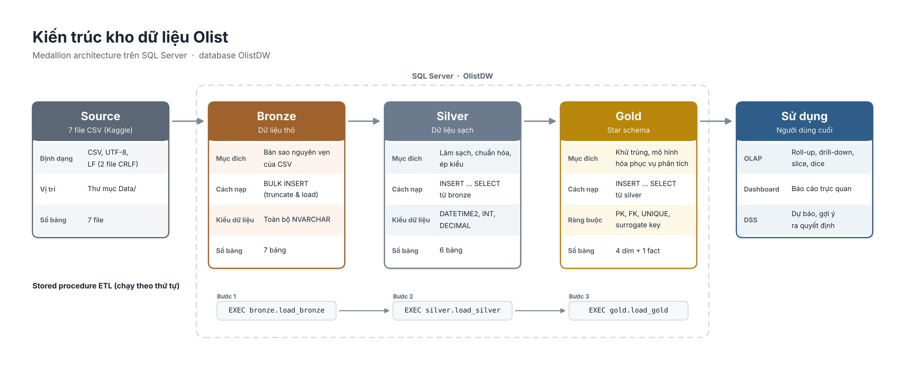
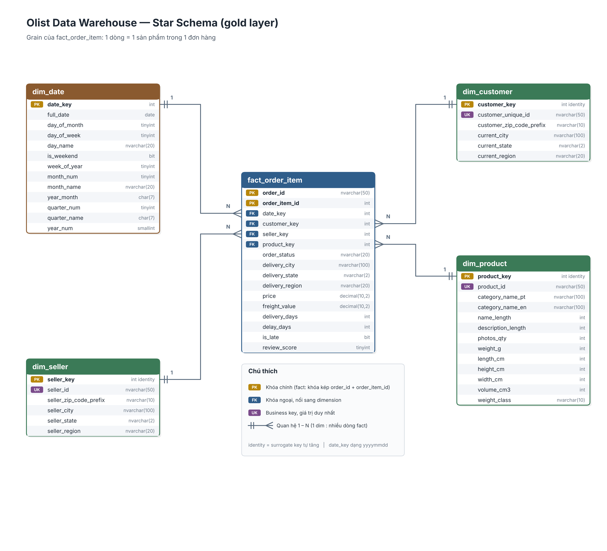

# Olist Data Warehouse

Data Warehouse trên **SQL Server** cho bộ dữ liệu thương mại điện tử Brazil [Olist](https://www.kaggle.com/datasets/olistbr/brazilian-ecommerce), xây dựng theo kiến trúc **Medallion (Bronze → Silver → Gold)**. Tầng Gold là một **star schema** sẵn sàng cho phân tích và dashboard.

---

## 1. Kiến trúc



---

## 2. Cấu trúc thư mục

```
Data_Warehouse_Project/
├── Data/                          # 7 file CSV nguồn (Olist)
├── Scripts/
│   ├── create_db/create_database.sql   # Tạo DB OlistDW + 3 schema
│   ├── bronze/
│   │   ├── ddl_bronze.sql              # Tạo 7 bảng bronze
│   │   └── proc_load_bronze.sql        # Procedure bronze.load_bronze
│   ├── silver/
│   │   ├── ddl_silver.sql              # Tạo 6 bảng silver
│   │   └── proc_load_silver.sql        # Procedure silver.load_silver
│   └── gold/
│       ├── ddl_gold.sql                # Tạo star schema (4 dim + 1 fact)
│       └── proc_load_gold.sql          # Procedure gold.load_gold
├── tests/test_dw.sql              # 75 test kiểm thử toàn bộ DW
└── docs/
    ├── architecture.png           # Sơ đồ kiến trúc Medallion
    └── star_schema.png            # Sơ đồ star schema
```

---

## 3. Cài đặt và chạy

### Yêu cầu
- **SQL Server 2017 trở lên** (dùng `TRIM`, `CREATE OR ALTER`, `DROP ... IF EXISTS`)
- SSMS hoặc Azure Data Studio

### ⚠️ Trước khi chạy: sửa đường dẫn CSV
Đường dẫn file CSV đang được ghi cứng trong [proc_load_bronze.sql](Scripts/bronze/proc_load_bronze.sql):
```sql
FROM 'C:\Users\Admin\Data_Warehouse_Project\Data\olist_orders_dataset.csv'
```
Mỗi thành viên phải **thay bằng đường dẫn trên máy mình** 

### Thứ tự chạy (lần đầu)

| Bước | File | Ghi chú |
|---|---|---|
| 1 | `Scripts/create_db/create_database.sql` | Tạo DB `OlistDW` và schema |
| 2 | `Scripts/bronze/ddl_bronze.sql` | Tạo bảng bronze |
| 3 | `Scripts/bronze/proc_load_bronze.sql` | Tạo procedure **và tự chạy load** (có `EXEC` ở cuối) |
| 4 | `Scripts/silver/ddl_silver.sql` | Tạo bảng silver |
| 5 | `Scripts/silver/proc_load_silver.sql` | Tạo procedure và tự chạy load |
| 6 | `Scripts/gold/ddl_gold.sql` | Tạo star schema |
| 7 | `Scripts/gold/proc_load_gold.sql` | Tạo procedure và tự chạy load |
| 8 | `tests/test_dw.sql` | Kiểm thử, kỳ vọng **ALL TESTS PASSED** |

### Load lại dữ liệu (các lần sau)
Không cần chạy lại DDL, chỉ cần:
```sql
EXEC bronze.load_bronze;
EXEC silver.load_silver;
EXEC gold.load_gold;
```
Thứ tự **bắt buộc** là bronze → silver → gold.

---

## 4. Star schema (tầng Gold)



**Grain của `fact_order_item`: 1 dòng = 1 sản phẩm trong 1 đơn hàng.**
Một đơn có 3 sản phẩm thì có 3 dòng trong fact.

### Các bảng

| Bảng | Khóa | Số dòng | Mô tả |
|---|---|---|---|
| `dim_date` | `date_key` (yyyymmdd) | 1,096 | Lịch liên tục 2016-01-01 → 2018-12-31, kể cả ngày không có đơn |
| `dim_customer` | `customer_key` (identity) | 96,096 | 1 dòng / **khách hàng thật** (`customer_unique_id`) |
| `dim_seller` | `seller_key` (identity) | 3,095 | 1 dòng / người bán |
| `dim_product` | `product_key` (identity) | 32,951 | 1 dòng / sản phẩm, kèm danh mục tiếng Anh |
| `fact_order_item` | `(order_id, order_item_id)` | 112,650 | Doanh thu, phí ship, thời gian giao, review |

### Ý nghĩa các cột cần chú ý

| Cột | Ý nghĩa |
|---|---|
| `fact.date_key` | Ngày **đặt hàng** (`order_purchase_timestamp`) |
| `fact.delivery_city / state / region` | Địa chỉ giao **tại thời điểm đặt đơn đó** |
| `dim_customer.current_city / state / region` | Địa chỉ **mới nhất** của khách (lấy theo đơn gần nhất) |
| `fact.delivery_days` | Số ngày từ lúc đặt đến lúc khách nhận. `NULL` = chưa giao |
| `fact.delay_days` | Ngày giao thực tế − ngày dự kiến. **Dương = trễ, âm = sớm**, `NULL` = chưa giao |
| `fact.is_late` | `1` = giao trễ (`delay_days > 0`), `0` = đúng hạn/sớm, `NULL` = chưa giao |
| `fact.review_score` | Điểm review **của cả đơn** (1–5), lặp lại cho từng sản phẩm trong đơn |
| `dim_date.day_of_week` | **1 = Thứ 2 … 7 = Chủ nhật**, không phụ thuộc cấu hình `DATEFIRST` |
| `dim_date.week_of_year` | Tuần theo chuẩn **ISO** |
| `dim_product.category_name_en` | Không có danh mục → `'unknown'` |
| `dim_product.weight_class` | `light` < 1kg ≤ `medium` < 5kg ≤ `heavy`, `NULL` nếu thiếu cân nặng |
| `dim_customer.customer_region`, `seller_region` | 5 vùng Brazil: Norte, Nordeste, Centro-Oeste, Sudeste, Sul |

---

## 5. ⚠️ Lưu ý khi viết truy vấn phân tích

Đây là những lỗi **dễ mắc nhất** khi query trên star schema này:

### 5.1 Đếm đơn hàng: dùng `COUNT(DISTINCT order_id)`
Fact là theo **sản phẩm**, không phải theo đơn.
```sql
-- ❌ SAI: đếm số sản phẩm, không phải số đơn
SELECT COUNT(*) FROM gold.fact_order_item;
-- ✅ ĐÚNG
SELECT COUNT(DISTINCT order_id) FROM gold.fact_order_item;
```

### 5.2 Điểm review trung bình: tính theo đơn, không theo dòng
`review_score` bị lặp ở mỗi sản phẩm, nên đơn nhiều sản phẩm sẽ bị **tính trọng số nhiều lần**.
```sql
-- ❌ SAI: đơn 5 sản phẩm được tính 5 lần
SELECT AVG(CAST(review_score AS DECIMAL(3,2))) FROM gold.fact_order_item;
-- ✅ ĐÚNG
SELECT AVG(CAST(review_score AS DECIMAL(3,2)))
FROM (SELECT DISTINCT order_id, review_score FROM gold.fact_order_item) t;
```
Tương tự cho `delivery_days`, `delay_days`, `is_late` (cùng giá trị cho mọi sản phẩm trong 1 đơn).

### 5.3 Đếm khách hàng: dùng `customer_key` / `customer_unique_id`
Trong dữ liệu gốc, **mỗi đơn có một `customer_id` riêng**, kể cả cùng một người. Khách hàng thật là `customer_unique_id`, đã được dùng làm khóa của `dim_customer`.

### 5.4 Doanh thu = `price + freight_value`
Bộ dữ liệu **không có file payments**, nên doanh thu ở đây là giá bán + phí ship, **không phải** số tiền khách thực trả (không tính trả góp, voucher).

### 5.5 Phân tích giao hàng: lọc đơn đã giao
```sql
WHERE order_status = 'delivered' AND delivery_days IS NOT NULL
```

### 5.6 Tỷ lệ hủy đơn: đếm từ `silver.orders`
775 đơn không có sản phẩm nào (phần lớn bị hủy hoặc unavailable) nên **không có trong fact**. Đếm tỷ lệ hủy từ fact sẽ ra **thấp hơn thực tế**.


## 6. Kiểm thử

File [tests/test_dw.sql](tests/test_dw.sql) chứa **75 test** cho cả 3 tầng, chạy sau khi load xong:

- **Bronze**: số dòng khớp CSV, không còn ký tự `CHAR(13)`
- **Silver**: số dòng = bronze, ép kiểu không mất dữ liệu, khóa không trùng, dữ liệu sạch, không có bản ghi mồ côi
- **Gold**: số dòng dim/fact đúng, khóa duy nhất, toàn vẹn FK, `dim_date` liên tục, logic cột tính toán, **đối soát tổng tiền** gold = silver

Kết quả: `75 / 75 PASSED`. 


## 9. Truy vấn mẫu

**Doanh thu và số đơn theo tháng**
```sql
SELECT d.year_month,
       COUNT(DISTINCT f.order_id)          AS so_don,
       SUM(f.price + f.freight_value)      AS doanh_thu
FROM gold.fact_order_item f
JOIN gold.dim_date d ON d.date_key = f.date_key
GROUP BY d.year_month
ORDER BY d.year_month;
```

**Tỷ lệ giao trễ theo vùng**
```sql
SELECT delivery_region,
       COUNT(*)                                       AS so_don,
       AVG(CAST(is_late AS DECIMAL(5,4))) * 100       AS ty_le_tre_pct
FROM (SELECT DISTINCT order_id, delivery_region, is_late
      FROM gold.fact_order_item
      WHERE order_status = 'delivered' AND is_late IS NOT NULL) t
GROUP BY delivery_region
ORDER BY ty_le_tre_pct DESC;
```

**Top 10 danh mục theo doanh thu**
```sql
SELECT TOP 10 p.category_name_en,
       SUM(f.price) AS doanh_thu
FROM gold.fact_order_item f
JOIN gold.dim_product p ON p.product_key = f.product_key
GROUP BY p.category_name_en
ORDER BY doanh_thu DESC;
```
